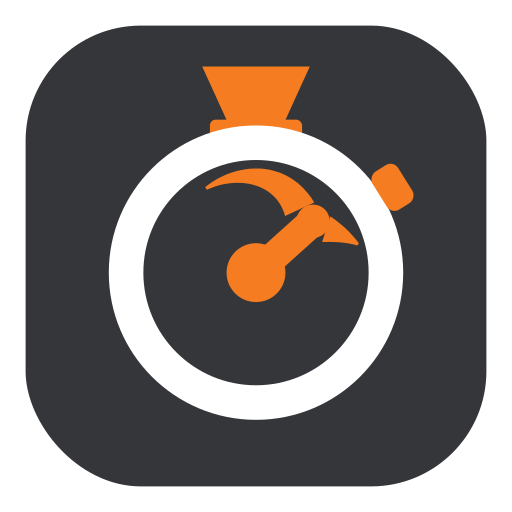
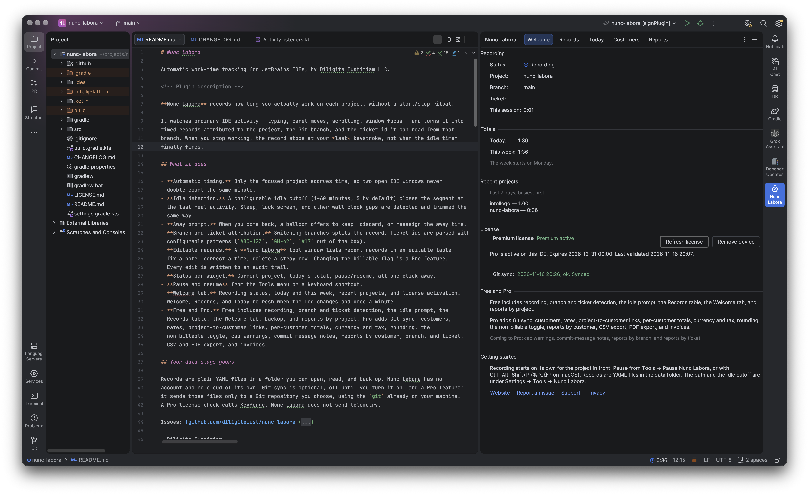
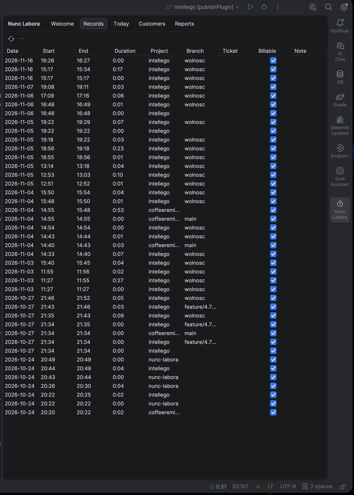
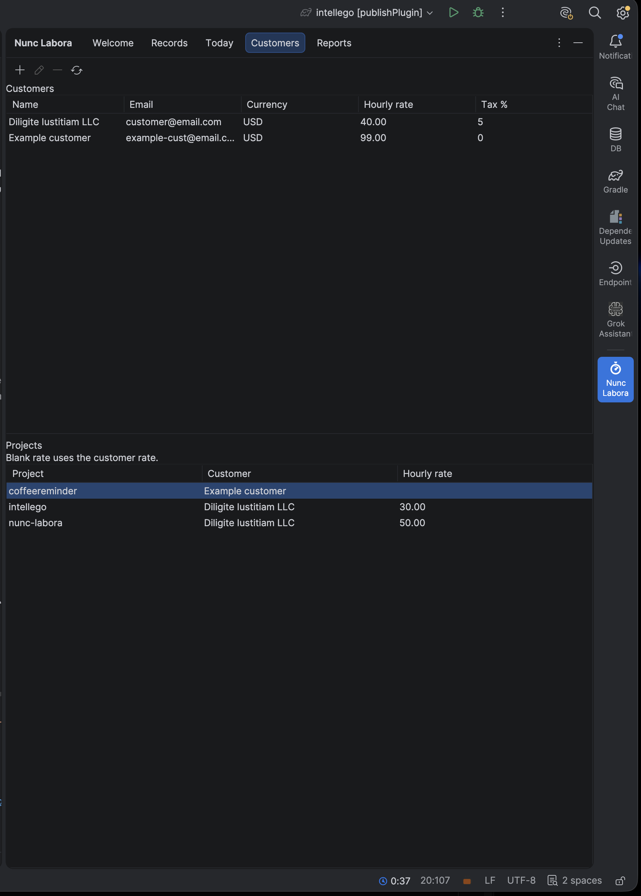
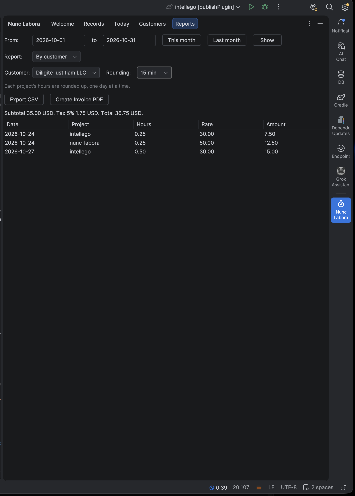

# Nunc Labora

  

Nunc Labora is a plugin for IntelliJ IDEA and other JetBrains IDEs. It records how long you work in each project, automatically, while you code. Idle time is detected. Your records stay as YAML files in a folder you choose. There is no account and no telemetry.

This is the **public support repo**. Open issues here. The commercial source is private.

## Free and Pro

Free includes automatic per-project tracking, idle detection, local-only YAML data, and reports by project.

Pro adds Git sync, customers and hourly rates, reports by customer with rounding and tax, CSV export, and PDF invoices.

[Pricing](https://diligiteiustitiam.world/nunclabora/premium/): monthly $4.99, yearly $49.90, or lifetime $99. Subscriptions start with a 14-day free trial. A lifetime license includes lifetime updates.

## Screenshots

**Records**

**Customers**

**Reports**

## Install

A JetBrains Marketplace listing is coming. Until then, install from a zip:

1. In the IDE, open **Settings → Plugins**.
2. Click the gear icon and choose **Install Plugin from Disk…**
3. Select the Nunc Labora zip.

## Support

Open an [issue](https://github.com/diligiteiust/nunc-labora-plugin/issues) in this repo and pick a template. Please include:

- IDE name and version (Help → About)
- Nunc Labora version (Welcome tab or Settings → Plugins)
- Your operating system
- What you did, what you expected, and what happened

Do **not** paste a license key in a public issue. For billing or private license questions, use the contact on the [website](https://diligiteiustitiam.world/nunclabora/).

New issue: https://github.com/diligiteiust/nunc-labora-plugin/issues/new/choose

## Links

- [Product page](https://diligiteiustitiam.world/nunclabora/)
- [Privacy policy](https://diligiteiustitiam.world/privacy/)
- [Buy Pro](https://diligiteiustitiam.world/nunclabora/premium/)

— Diligite Iustitiam LLC
